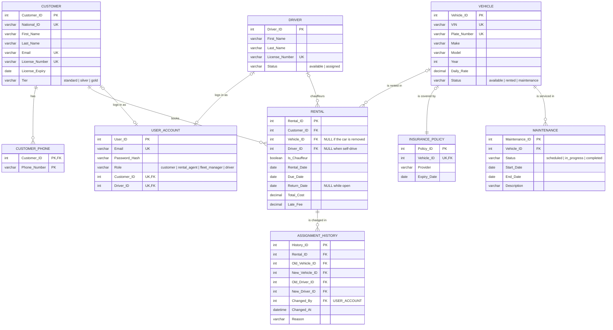

# Car Rental ER Diagram

Source of truth: `schema.sql`. Open this file on GitHub (or paste the block into
<https://mermaid.live>) to see the diagram.

## Notes

- **Rental status is derived, never stored.** `returned` when `Return_Date` is set,
  `overdue` when `Due_Date < CURDATE()`, otherwise `active`.
- **One policy per car.** `INSURANCE_POLICY.Vehicle_ID` is `UNIQUE`; saving a policy
  for a car that already has one renews it.
- **Deleting a car keeps history.** `RENTAL.Vehicle_ID` and both vehicle columns in
  `ASSIGNMENT_HISTORY` use `ON DELETE SET NULL`.
- **Tier is automatic.** `trg_update_tier` recalculates `CUSTOMER.Tier` when a rental's
  `Return_Date` goes from `NULL` to a date: 0-4 standard, 5-9 silver, 10+ gold.
- **A login belongs to at most one person.** `USER_ACCOUNT.Customer_ID` and
  `Driver_ID` are both `UNIQUE`; agents and managers have neither.
